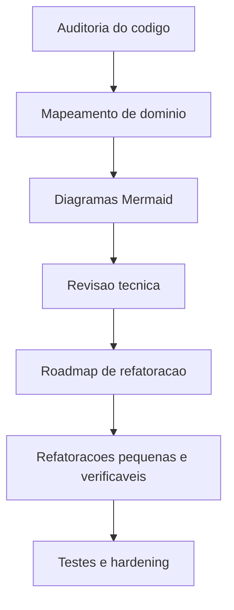

# Documentacao Tecnica - PASCOM Stream View

## Objetivo

Centralizar a auditoria inicial, o inventario tecnico, os fluxos Mermaid, os riscos e o plano de evolucao do projeto.

## Documentos

- [Visao geral e arquitetura](./visao-geral.md)
- [Estrutura de pastas](./estrutura-de-pastas.md)
- [Fluxos da aplicacao](./fluxos.md)
- [Banco de dados](./banco-de-dados.md)
- [APIs](./apis.md)
- [Componentes, hooks, services e providers](./componentes-hooks-services.md)
- [Autenticacao, seguranca, logs e integracoes](./seguranca-operacao.md)
- [Cache e midia](./cache-e-midia.md)
- [Docker, deploy, build e testes](./devops-testes.md)
- [Deploy, ambientes e operacao](./deploy.md)
- [Guia do desenvolvedor](./guia-do-desenvolvedor.md)
- [Guia do usuario](./guia-do-usuario.md)
- [Convencoes, boas praticas, FAQ e glossario](./convencoes-faq-glossario.md)
- [Revisao tecnica, roadmap e relatorio final](./relatorio-tecnico.md)

## Fluxograma

## Limitacoes Desta Etapa

A documentacao abaixo cobre a auditoria e a proposta tecnica. Refatoracoes estruturais foram deliberadamente adiadas para preservar comportamento e permitir validacao incremental.
