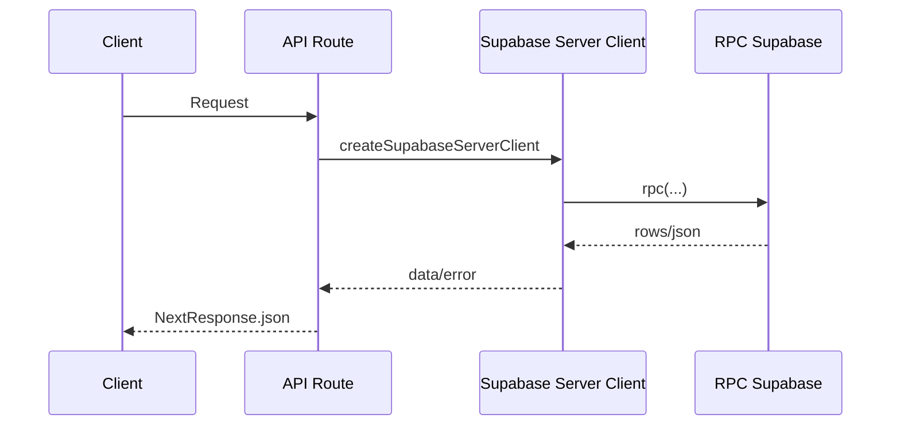

# APIs

## Objetivo

Documentar endpoints, payloads, respostas, erros, status HTTP, middleware e autenticacao.

## Endpoints

| Metodo | Rota | Responsabilidade |
| --- | --- | --- |
| GET | `/api/anunciantes` | Lista diretorio publico de patrocinadores |
| GET | `/api/anunciantes/:id` | Detalhe publico e logs de um patrocinador |
| POST | `/api/anunciantes/logs` | Registra exibicoes do telao |
| GET | `/api/ads-novenario` | Retorna playlist publica e settings |

## Fluxo da API



## Payload de Logs

```json
{
  "sponsorId": "uuid",
  "displayedAt": "2026-07-06T12:00:00.000Z",
  "durationSeconds": 10,
  "source": "telao"
}
```

Tambem aceita `{ "logs": [...] }`.

## Erros

- `400`: `sponsorId` ausente em logs.
- `404`: anunciante nao encontrado.
- `500`: falha Supabase/RPC/ambiente.

## Limitacoes

- O POST de logs executa RPC em loop sequencial.
- Erros expostos usam mensagens originais quando `error instanceof Error`.
- Nao ha rate limiting no nivel da API.
- Nao ha schema Zod para validar payloads.
