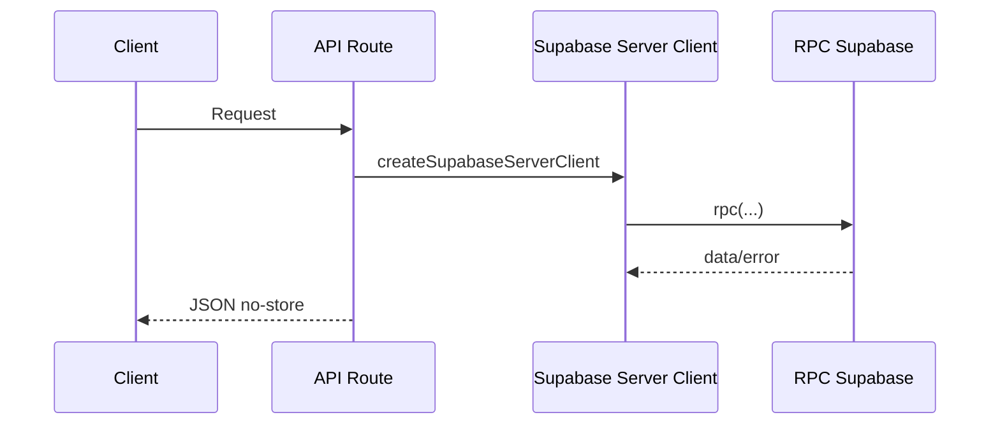

# APIs

## Endpoints

| Metodo | Rota | Responsabilidade |
| --- | --- | --- |
| GET | `/api/ads-novenario` | Playlist publica e settings do telao |
| GET | `/api/anunciantes` | Diretorio publico de patrocinadores |
| GET | `/api/anunciantes/:id` | Detalhe publico e logs de patrocinador |
| POST | `/api/anunciantes/logs` | Registro de exibicoes do telao |
| GET | `/api/perfil-paroquia` | Perfil publico da paroquia |

Todas as respostas publicas usam `Cache-Control: no-store`.

## Fluxo



## Logs de Exibicao

Payload unico:

```json
{
  "sponsorId": "00000000-0000-4000-8000-000000000001",
  "displayedAt": "2026-07-13T12:00:00.000Z",
  "durationSeconds": 10,
  "source": "telao"
}
```

Payload em lote:

```json
{
  "logs": [
    {
      "sponsorId": "00000000-0000-4000-8000-000000000001",
      "durationSeconds": 10,
      "source": "telao-master"
    }
  ]
}
```

## Validacoes

- Zod valida logs.
- `source` deve representar `telao` ou `telao-master` no banco.
- Duracao e limitada.
- Rate limit em memoria protege o POST de logs.
- RPC ignora logs quando contador esta desativado, tipo pausado ou patrocinador inativo.

## Status

- `200`: sucesso.
- `400`: payload invalido.
- `404`: patrocinador nao encontrado.
- `429`: muitas requisicoes.
- `500`: falha Supabase/RPC.
