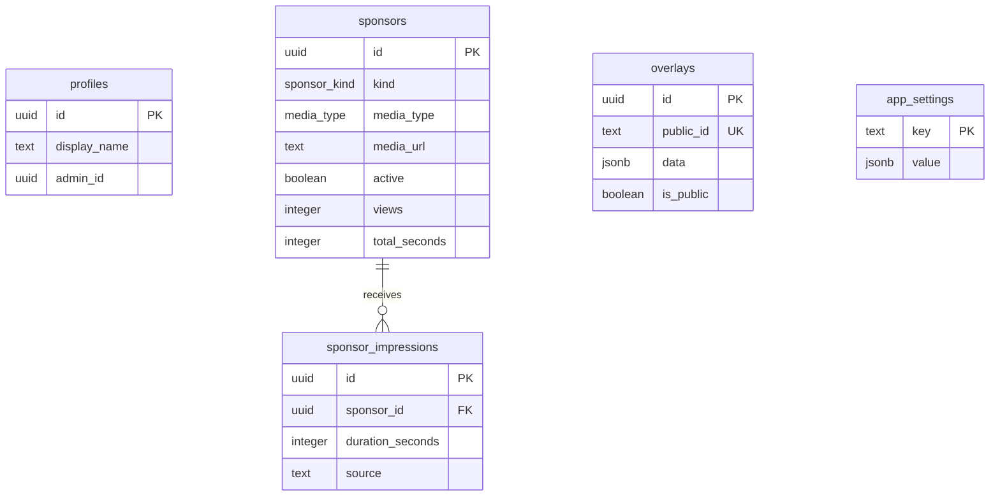
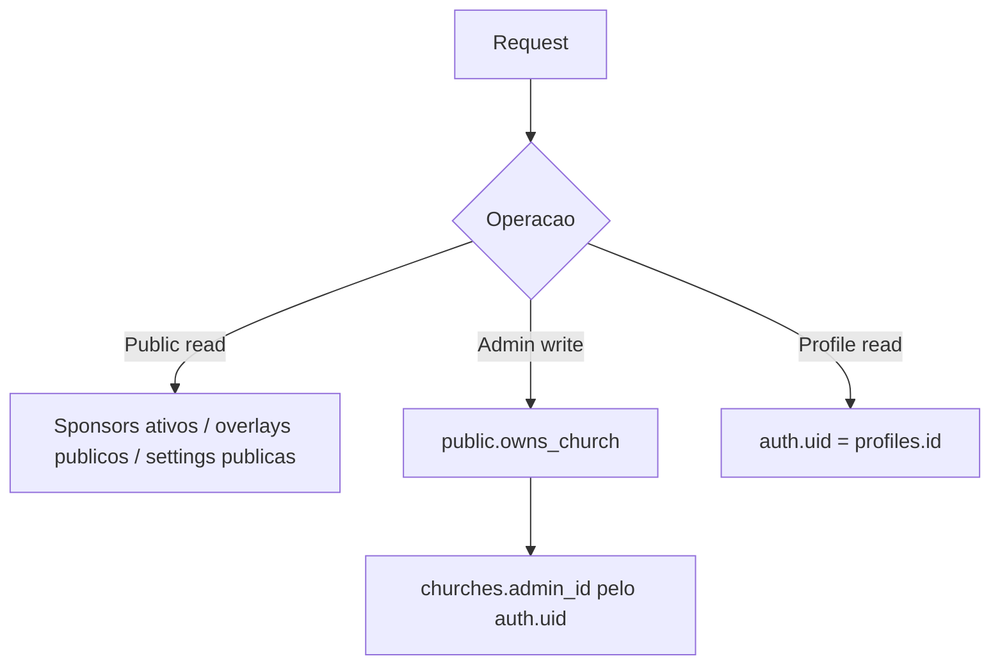

# Banco de Dados

> Snapshot atual: `supabase/schema.sql`. Para bancos existentes, aplique as migrations; não execute o snapshot inteiro sobre um banco já criado.

## Tabelas

- `profiles`: perfil básico do usuário Supabase.
- `churches`: dados, slug, estado público (`is_active`) e o único administrador (`admin_id`).
- `sponsors`: patrocinadores, tipo, midia, status, duracao e metricas.
- `overlays`: overlays publicos/administrativos com `public_id`.
- `app_settings`: configuracoes JSON (`sponsor_settings`, `admin_settings`).
- `sponsor_impressions`: logs de exibicao.

## ER

## Enums

- `sponsor_kind`: `NORMAL`, `MASTER`.
- `media_type`: `image`, `video`.

## Constraints e Indices

- Nome de patrocinador nao vazio.
- Duracao positiva.
- Midia obrigatoria e tipo `image`/`video`.
- Dimensoes de overlay positivas.
- `overlays.public_id` unico.
- Indices em status/tipo de patrocinador, public id e logs por data.

## RPCs Principais

- `get_public_sponsors`
- `get_sponsor_settings`
- `get_public_sponsor_directory`
- `get_public_sponsor_detail`
- `get_public_sponsor_impressions`
- `get_public_overlay`
- `get_public_parish_profile`
- `log_sponsor_impression`
- `log_sponsor_impressions`

## RLS

## Settings

`sponsor_settings` guarda:

- `metricsEnabled`
- `metricsPaused.NORMAL`
- `metricsPaused.MASTER`
- designs por tipo `NORMAL` e `MASTER`

`admin_settings` guarda duracoes padrao e identidade publica da paroquia.

## Cuidados

- Manter `schema.sql` sincronizado com migrations.
- Revisar RPCs `security definer` ao alterar tabelas.
- Aplicar migrations novas antes do deploy.
- A migration `015_remove_legacy_metrics.sql` remove somente RPCs e view sem uso. A tabela histórica `telao_sessions` não é apagada automaticamente; faça backup e remova-a apenas quando confirmar que não precisa do histórico.
