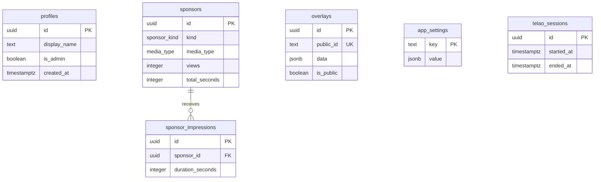
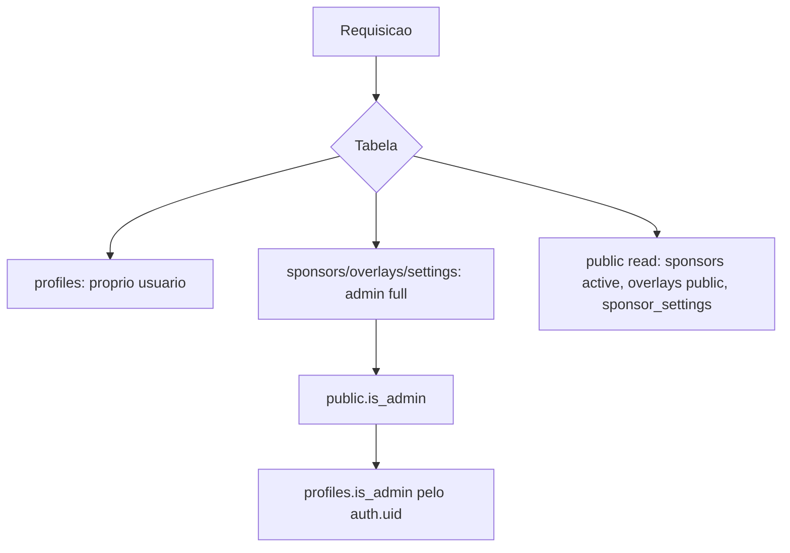

# Banco de Dados

## Objetivo

Documentar tabelas, relacionamentos, constraints, indices, migrations, seeds, RLS e fluxo de acesso.

## Tabelas

- `profiles`: perfil do usuario Supabase, com `is_admin`.
- `sponsors`: patrocinadores/anunciantes, midia, duracao, status e metricas.
- `overlays`: overlays com `public_id`, dimensoes e `data.elements`.
- `app_settings`: configuracoes JSON por chave.
- `telao_sessions`: sessoes historicas do telao.
- `sponsor_impressions`: logs de exibicao por patrocinador.

## ER

## Constraints e Indices

- Checks de nome nao vazio, duracao positiva e dimensoes positivas.
- `overlays.public_id` unico.
- Indices em `sponsors.active`, `sponsors.kind`, `overlays.public_id`, sessoes e impressions.

## RPCs

- `get_public_stats`
- `get_public_sponsors`
- `get_public_sponsor_directory`
- `get_public_overlay`
- `get_sponsor_settings`
- `log_sponsor_impression`
- `record_sponsor_view`
- `get_public_sponsor_detail`
- `get_public_sponsor_impressions`

## RLS

## Limitacoes

- RPCs `security definer` devem ser revisadas periodicamente.
- Operacoes administrativas via browser dependem de RLS, sem camada server-side propria.
- `schema.sql` e migrations devem permanecer sincronizados.
