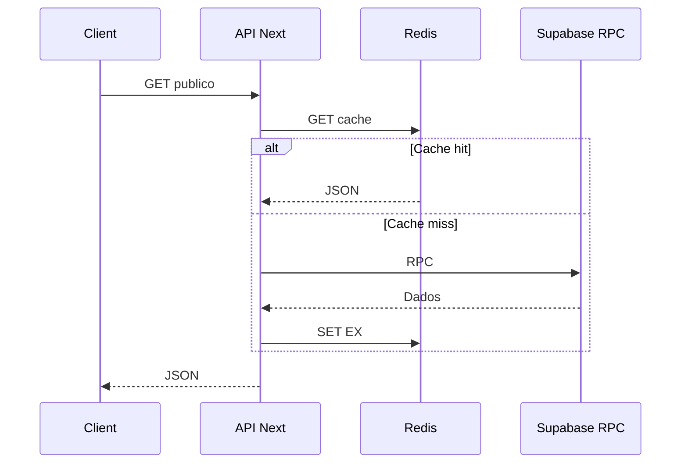

# Cache e Midia

## Objetivo

Documentar o cache Redis opcional e a politica de arquivos de midia.

## Redis

O projeto usa Redis opcional quando estas variaveis estao configuradas:

```env
UPSTASH_REDIS_REST_URL=
UPSTASH_REDIS_REST_TOKEN=
REDIS_URL=
REDIS_CACHE_PREFIX=
REDIS_REST_URL=
REDIS_REST_TOKEN=
```

Sem essas variaveis, a aplicacao segue funcionando sem cache externo.
Use `REDIS_URL` para Redis TCP/TLS tradicional e as variaveis `UPSTASH_*` ou `REDIS_REST_*` para Redis REST.
Use `REDIS_CACHE_PREFIX` para prefixar todas as chaves e evitar colisao com outros projetos.

## Dataset Redis

O dataset operacional fica registrado como metadado persistente nestas chaves:

```text
dataset:pascom-stream-view:latest
dataset:pascom-stream-view:v1
```

Ele documenta as chaves de cache usadas pelas APIs:

```text
api:ads-novenario:v1        TTL 10s
api:anunciantes:v1          TTL 30s
api:anunciantes:{id}:v1     TTL 30s
```

Com `REDIS_CACHE_PREFIX=virtus-cache`, as mesmas chaves passam a ser gravadas como:

```text
virtus-cache:dataset:pascom-stream-view:latest
virtus-cache:dataset:pascom-stream-view:v1
virtus-cache:api:ads-novenario:v1
virtus-cache:api:anunciantes:v1
virtus-cache:api:anunciantes:{id}:v1
```

Para criar ou atualizar o dataset:

```bash
npm run redis:dataset
```

As chaves das APIs nao sao populadas por seed para evitar payload falso. Elas sao gravadas com dados reais no primeiro acesso das rotas publicas.



## Midia

- Imagens JPEG, PNG e WebP sao otimizadas no navegador para WebP com qualidade 0.86 e lado maximo de 2560px.
- GIF e preservado para evitar perda de animacao.
- Videos aceitos: WebM e MP4.
- Para menor espaco, prefira WebM; para maior compatibilidade, use MP4.
- O limite atual de upload e 100MB.

## Limitacoes

O projeto nao faz transcodificacao de video no browser. Para compressao real de video, recomenda-se pipeline server-side ou ferramenta externa antes do upload.
