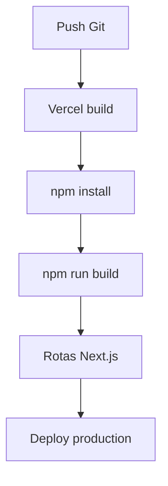

# Deploy, Ambientes e Operacao

## Objetivo

Documentar deploy em Vercel ou Node, variaveis de ambiente, setup Supabase e rotinas de backup/restore.

## Variaveis

```env
NEXT_PUBLIC_SUPABASE_URL=
NEXT_PUBLIC_SUPABASE_ANON_KEY=
REDIS_URL=
REDIS_CACHE_PREFIX=
UPSTASH_REDIS_REST_URL=
UPSTASH_REDIS_REST_TOKEN=
REDIS_REST_URL=
REDIS_REST_TOKEN=
```

`NEXT_PUBLIC_SUPABASE_URL` e `NEXT_PUBLIC_SUPABASE_ANON_KEY` sao obrigatorias para client e server.
Redis e opcional; quando configurado, as APIs publicas usam cache com TTL curto.

## Vercel



Passos:

1. Configurar as variaveis no painel do projeto.
2. Garantir Node compativel com Next 16 e React 19.
3. Executar `npm run build` localmente antes do deploy.
4. Rodar `npm run redis:dataset` quando criar ou trocar namespace Redis.

## Node

```bash
npm ci
npm run build
npm run start
```

Use um process manager externo para manter o processo ativo e configurar restart automatico.

## Supabase

Setup esperado:

- Auth habilitado.
- Tabelas e RPCs aplicadas pelo schema/migrations do projeto.
- RLS ativo nas tabelas sensiveis.
- Storage bucket `pascom-media`.
- Politicas de storage revisadas para leitura publica somente quando necessario.

## Backup e Restore

Backup recomendado:

- Exportar schema e dados do Supabase em rotina programada.
- Fazer backup do bucket `pascom-media`.
- Guardar uma copia das variaveis de ambiente fora do repositorio.
- Registrar a versao do dataset Redis com `npm run redis:dataset`.

Restore recomendado:

1. Restaurar banco Supabase.
2. Restaurar arquivos do bucket.
3. Reaplicar variaveis no ambiente.
4. Rodar `npm run redis:dataset`.
5. Executar smoke test nas rotas `/`, `/telao`, `/telao-master` e `/api/anunciantes`.

## Limitacoes

O projeto ainda nao possui Dockerfile nem pipeline CI/CD versionado. A validacao atual depende dos scripts npm locais.
