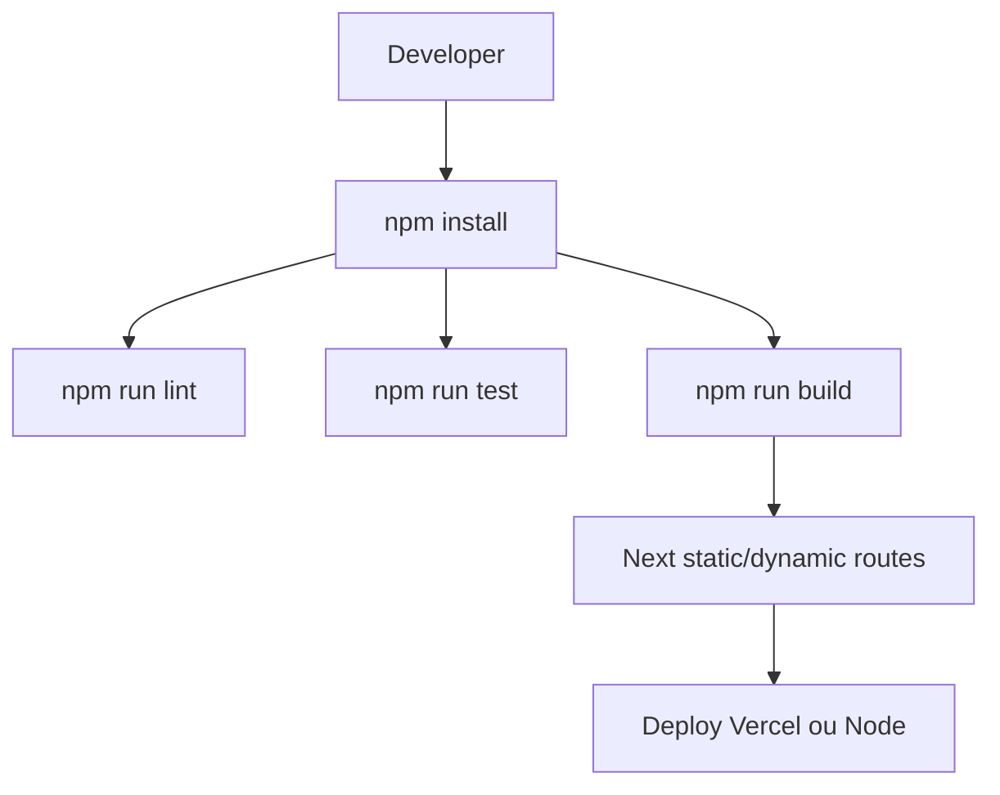

# Docker, Deploy, Build e Testes

## Objetivo

Documentar estado de DevOps, build, deploy e cobertura de testes.

## Build

Validado com:

```bash
npm install
npm run build
```

Resultado: build Next.js passou fora do sandbox. O build executa TypeScript porque `typescript.ignoreBuildErrors` foi removido.

## Lint

`npm run lint` executa com `eslint.config.mjs` e termina sem erros.

## Typecheck

`npm run typecheck` executa `tsc --noEmit -p jsconfig.json` e termina sem erros.

## Docker

Nao foram encontrados `Dockerfile`, `docker-compose.yml` ou configs de container.

## Deploy

O app e compativel com Vercel/Next e tambem pode rodar em Node com `npm run build` seguido de `npm run start`.
As variaveis esperadas estao em `.env.example` e incluem Supabase, Redis TCP/REST e prefixo de cache.

## Testes

`npm run test` executa Vitest. A cobertura inicial inclui mappers de patrocinadores, validacao de logs de exibicao, validacao/sanitizacao de upload e helpers puros do gerador XLSX.

Os testes ficam organizados em `tests/unit`.

## Diagrama



## Lacunas de Teste

- Expandir cobertura de mappers e payload builders.
- Repositories Supabase depois da extracao.
- `simple-xlsx` e geracao de XML/ZIP.
- `TelaoPlayer`: cache, fila offline, rotacao e logs.
- API routes: status 400/404/500.
- RLS/RPCs via testes SQL ou integracao.
