# Estrutura de Pastas

## Objetivo

Registrar responsabilidades de cada pasta e apontar reorganizacoes futuras.

## Inventario

```text
app/                 Rotas Next.js, layouts, paginas e APIs.
components/dashboard/ Componentes do dashboard administrativo.
components/layout/    Shell, sidebar e providers de layout.
components/overlays/  Biblioteca, criacao e editor de overlays.
components/shared/    Componentes reutilizaveis de dominio.
components/sponsors/  Patrocinadores e player do telao.
components/ui/        Componentes shadcn/Radix usados pelo app.
hooks/ui/             Hooks de comportamento visual.
lib/cache/            Redis opcional e rate limit em memoria.
lib/export/           Exportadores de arquivos, como XLSX simples.
lib/mappers/          Conversores entre Supabase e dominio.
lib/repositories/     Acesso a RPCs e persistencia por dominio.
lib/services/         Montagem de payloads e regras de aplicacao.
lib/store/            Store global e provider de estado.
lib/utils/            Utilitarios compartilhados.
services/supabase/   Clientes Supabase e upload de midia.
styles/              CSS global adicional.
supabase/            Schema, migrations, RLS, RPCs e storage.
```

## Fluxograma

```mermaid
flowchart TD
  app --> Admin["(admin): painel, editor, overlay, configuracoes"]
  app --> Public["(public): dashboard, login, telao, shared, anunciantes"]
  app --> Api["api: anunciantes, logs, ads-novenario"]
  components --> Dashboard[dashboard]
  components --> Layout[layout]
  components --> Overlays[overlays]
  components --> Sponsors[sponsors]
  components --> Shared[shared]
  components --> UI[ui]
  hooks --> HooksUI[ui hooks]
  lib --> Cache[cache]
  lib --> Export[export]
  lib --> Mappers[mappers]
  lib --> Repositories[repositories]
  lib --> Services[services]
  lib --> Store[store]
  lib --> Utils[utils]
  services --> Supabase[Supabase clients]
  supabase --> Migrations[Migrations SQL]
```



## Melhorias Recomendadas

- Criar `features/` por dominio.
- Mover mappers duplicados para `features/sponsors/mappers`.
- Separar novas partes de overlays/settings em repositories e services.
- Padronizar JS/TS: migrar dominio gradualmente para TypeScript.
- Manter em `components/ui/**` apenas componentes usados e validos em TSX; componentes gerados mortos foram removidos para preservar typecheck limpo.
- Manter novos componentes dentro da pasta de dominio correspondente, evitando arquivos soltos em `components/`.

## Limitacoes

Ainda nao existem pastas explicitas para entities, schemas ou use cases.
