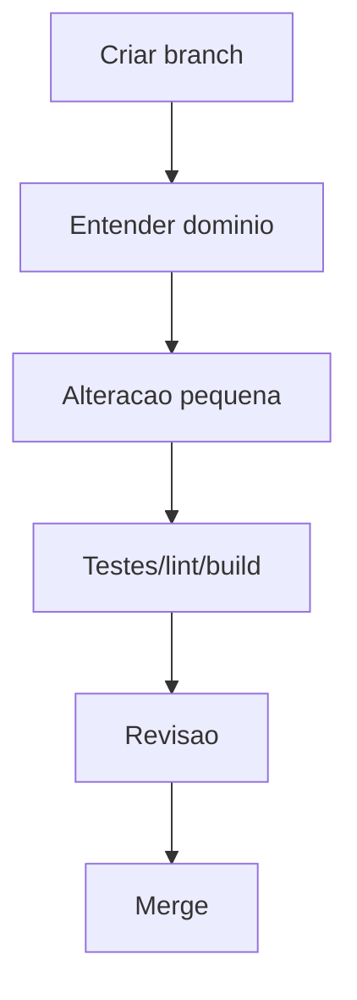

# Guia do Desenvolvedor

## Objetivo

Orientar setup, execucao local, convencoes e checklist de novos contribuidores.

## Setup

```bash
npm install
npm run dev
```

Variaveis esperadas:

```env
NEXT_PUBLIC_SUPABASE_URL=
NEXT_PUBLIC_SUPABASE_ANON_KEY=
```

## Checklist Inicial

- Usar uma unica familia de lockfile.
- Corrigir Node para versao compativel com dependencias.
- Manter `eslint.config.mjs` rodando sem erros.
- Corrigir `components/ui/**` antes de ativar typecheck como gate.
- Criar `.env.example`.
- Rodar build antes de PR.
- Evitar novas regras de negocio em componentes gigantes.

## Fluxo de Desenvolvimento



## Boas Praticas

- Preferir server/API/repository para persistencia.
- Centralizar mappers.
- Tratar erros com mensagens estaveis.
- Criar testes para bugs antes de corrigir.
- Documentar decisoes arquiteturais relevantes.
