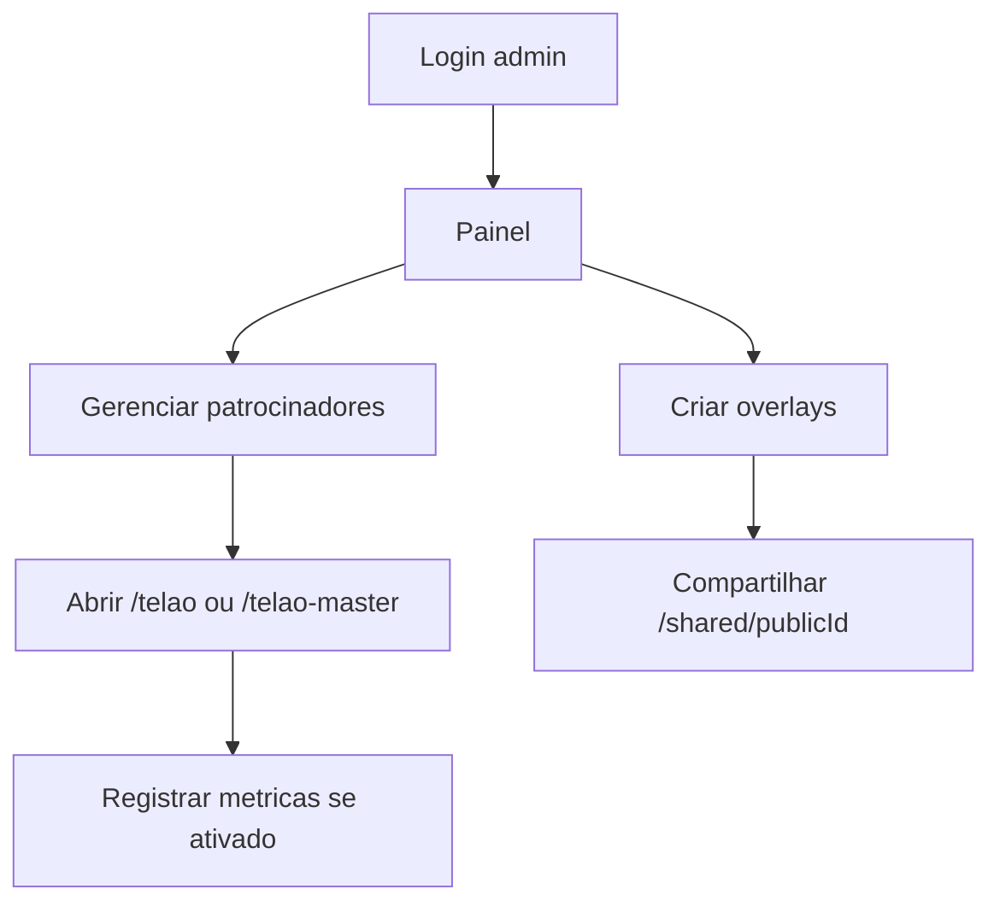

# Guia do Usuario

## Objetivo

Explicar os fluxos principais para operadores do sistema.

## Fluxos

## Operacao

- `/login`: entrada administrativa.
- `/painel-telao`: cadastro, edicao, ativacao e relatorios de patrocinadores.
- `/overlay`: biblioteca de overlays.
- `/editor/:id`: editor visual.
- `/`: pagina publica principal.
- `/telao`: exibicao normal.
- `/telao-master`: exibicao master.
- `/shared/:id`: overlay publico para OBS/transmissao.

## Limitacoes

- Painel administrativo bloqueia mobile.
- Metricas so contam quando habilitadas.
- Player pode exibir cache local quando offline.
