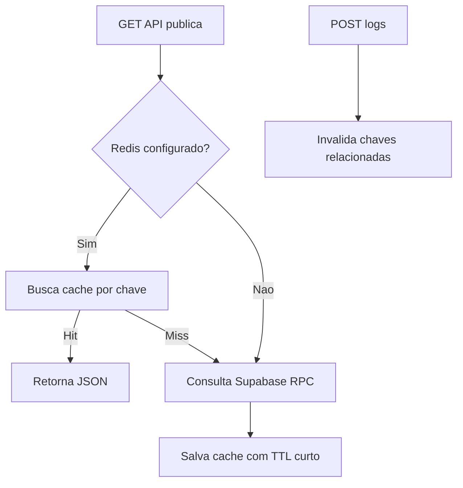

# Autenticacao, Seguranca, Logs e Integracoes

## Objetivo

Registrar mecanismos de protecao, integracoes externas, logs e riscos operacionais.

## Autenticacao

O `proxy.js` protege rotas admin e permite rotas publicas/API. Usa Supabase SSR e `auth.getUser`.

```mermaid
flowchart TD
  A[Request] --> B{Public path ou API?}
  B -- Sim --> C[Permite]
  B -- Nao --> D{Admin path?}
  D -- Nao --> C
  D -- Sim --> E[Valida env Supabase]
  E --> F[auth.getUser]
  F -- Invalido --> G[/login]
  F -- Valido --> C
```

## Autorizacao

A autorizacao real de escrita e feita por RLS no Supabase com `public.is_admin()`.

## Integracoes

- Supabase Auth
- Supabase Postgres/RPC/RLS
- Supabase Storage bucket `pascom-media`
- Vercel Analytics em producao
- Redis opcional, via `REDIS_URL`, `UPSTASH_REDIS_REST_URL`/`UPSTASH_REDIS_REST_TOKEN` ou `REDIS_REST_URL`/`REDIS_REST_TOKEN`, para cache das APIs publicas.

## Logs

Logs de exibicao sao persistidos em `sponsor_impressions` quando `metricsEnabled` esta ativo. O player guarda fila offline em `localStorage`.

## Cache



As chaves atuais sao:

- `api:ads-novenario:v1`
- `api:anunciantes:v1`
- `api:anunciantes:{id}:v1`

## Riscos

- `/logout` possui route handler local e chama `supabase.auth.signOut`.
- APIs publicas de log tem rate limit simples; demais rotas publicas dependem de TTL/cache e RLS/RPC.
- Upload valida tamanho, tipo de arquivo e otimiza imagens para WebP.
- `NEXT_PUBLIC_SUPABASE_*` e obrigatorio no client e server.
- Texto com mojibake afeta confiabilidade e experiencia.
