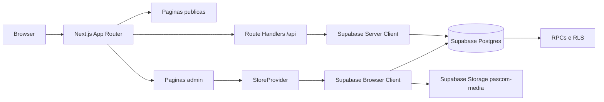

# Visao Geral e Arquitetura

## Objetivo

Explicar a arquitetura atual do PASCOM Stream View e como os dominios principais se conectam.

## Descricao

O PASCOM Stream View e uma aplicacao Next.js App Router com Supabase para operar patrocinadores, teloes e overlays de transmissao. O painel administrativo e protegido por login e permissao de admin; as rotas publicas exibem patrocinadores, relatorios, telao normal, telao master e overlays compartilhaveis.

## Arquitetura

## Dominios

- Patrocinadores: cadastro, upload de midia, ativacao, playlist e metricas.
- Telao: exibicao NORMAL e MASTER, realtime, cache local e fila offline de logs.
- Overlays: biblioteca, editor visual e links publicos para transmissao.
- Perfil publico: identidade da paroquia, capa, logo e redes sociais.
- Relatorios: historico publico por patrocinador e exportacao XLSX.

## Camadas

- `app`: rotas, paginas e route handlers.
- `components`: UI e componentes por dominio.
- `lib/repositories`: acesso Supabase/RPC.
- `lib/services`: regras de aplicacao e montagem de payload.
- `lib/mappers`: conversao entre linhas do banco e formato de tela.
- `lib/store`: provider global usado pelo admin.
- `services/supabase`: clients browser/server e upload.
- `supabase`: schema, migrations, RLS, RPCs e storage.

## Regras Importantes

- Admin nao funciona em mobile.
- Admin exige usuario autenticado e `profiles.is_admin = true`.
- Escritas dependem de RLS no Supabase.
- APIs publicas retornam `no-store`.
- Links publicos externos sao filtrados para `http/https`.
- Contador de exibicoes pode pausar NORMAL e MASTER separadamente.

## Direcao de Refatoracao

Manter refatoracoes incrementais e verificaveis. Prioridades futuras:

- extrair dominios para `features/sponsors`, `features/overlays` e `features/settings`;
- migrar regras de dominio para TypeScript gradualmente;
- reduzir o tamanho de componentes grandes como editor de overlay e pagina publica;
- adicionar testes de integracao para RPC/RLS em ambiente Supabase isolado.
