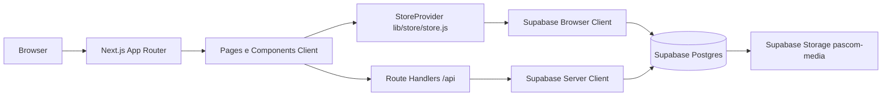

# Visao Geral e Arquitetura

## Objetivo

Explicar o que a aplicacao faz, quais dominios existem e como os modulos principais se comunicam.

## Descricao

O PASCOM Stream View e uma aplicacao Next.js App Router com Supabase. Ela possui:

- painel administrativo protegido por autenticacao Supabase;
- cadastro e gerenciamento de patrocinadores;
- player publico do telao normal e master;
- editor de overlays para transmissao;
- rotas publicas de dashboard, compartilhamento e relatorios;
- APIs server-side que encapsulam leituras publicas e logs de exibicao.

## Arquitetura Atual

## Modulos

- `app`: rotas Next.js, publicas, admin e API.
- `components`: componentes de dominio e UI base.
- `lib`: store global, utilitarios e gerador XLSX artesanal.
- `services/supabase`: factories de cliente Supabase e upload.
- `supabase`: migrations e schema consolidado.
- `hooks`: atalhos para hooks reutilizaveis.

## Boas Praticas Existentes

- Uso de RLS no banco.
- Separacao de clients Supabase browser/server.
- APIs publicas usando RPCs em vez de expor queries complexas no client.
- Player com cache offline e fila de logs.

## Limitacoes

- `StoreProvider` mistura estado, repositories, mappers e persistencia.
- Componentes grandes concentram regras de negocio.
- Tipagem strict existe no `jsconfig`, mas o codigo de dominio esta majoritariamente em JS/JSX.
- `next.config.mjs` ignora erros TypeScript no build.

## Extensibilidade

Antes de novas features, recomenda-se criar uma camada de dominio: `features/sponsors`, `features/overlays`, `features/settings`, cada uma com schemas, repositories, services e componentes.
